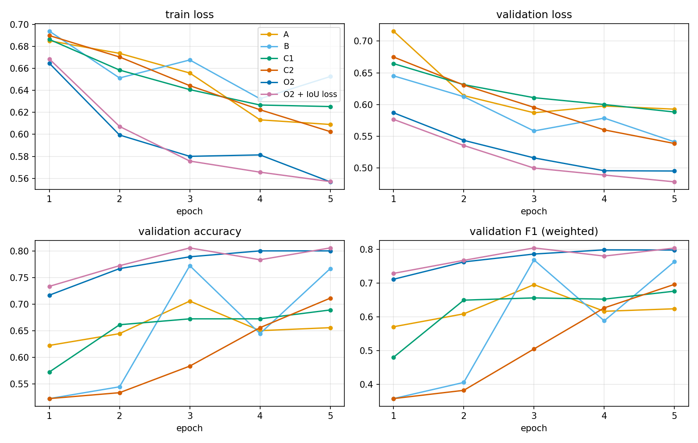

# Herbarium specimens and CrossViT

Binary classification of digitised herbarium sheets: does the specimen have spines or not. This is the Deep
Learning module project at CY Tech (2025-2026, supervised by Dr. Youcef Sklab, team of two: Haroun Joudi and
Amine Filali; I wrote most of the implementation, data pipeline, model, training and evaluation, and the report
and slides were joint work). A sheet carries a lot of visual noise (labels, rulers, colour charts, barcodes),
and every specimen comes with two aligned images: the full sheet and a segmented version with only the plant on
a black background. The question is how much that segmentation helps a Vision Transformer, and whether the
mask can steer the model's attention.

## Model and objectives

The model is a CrossViT (Chen et al., 2021): two ViT encoders, one with 12x12 patches (small branch, width 192)
and one with 16x16 patches (large branch, width 384), 8 blocks and 8 heads each, joined by a cross-attention
fusion. The brief defined five objectives:

- O1: four input configurations with the same hyper-parameters. A: full sheet only. B: segmented image only.
  C1: full sheet in the small branch, segmented image in the large one. C2: the reverse.
- O2: both branches with the same patch size and width (16x16, 384), separate weights, one per image.
- O3: a weight per patch from the plant density r_p of the segmented image, w_p = f(r_p), shared with the
  co-located patch of the full sheet.
- O4: interpretability: attention rollout to the [CLS] token and IoU of the thresholded map with the plant mask.
- O5: an IoU term in the loss, so the model is penalised when it looks at the background.

```
src/
  api_client.py        access to the private image server (credentials from .env)
  data.py              metadata, stratified 70/15/15 split, two-image dataset with plant mask
  model.py             PatchEmbed, Attention, Block, VisionTransformer, CrossAttentionFusion, DualImageCrossViT
  patch_weights.py     O3: plant ratio per patch and w_p = f(r_p)
  interpretability.py  O4: attention rollout, rollout map, IoU with the plant mask
  losses.py            O5: cross-entropy + soft IoU penalty
  train.py / evaluate.py / plot_histories.py   training, test evaluation, learning curves
notebooks/herbarium_crossvit.ipynb        the experiment notebook, training and evaluation outputs kept
results/                                  history_*.json of the six runs, learning curves, confusion matrices
docs/presentation_herbiers_crossvit.pdf   final slides (French)
```

## Results

898 specimens (407 without spines, 491 with), 224x224 inputs, batch 64, AdamW with lr 1e-5 and cosine
annealing, 5 epochs, no augmentation, one NVIDIA H100 80 GB, PyTorch 2.9 / CUDA 12.8. The six runs share the
same hyper-parameters. The O2 model has 29.7M parameters, A and B 14.6M. Validation metrics
(`results/history_*.json`) are the best of the five epochs on the 180-image validation set; test metrics (last
cell of the notebook) come from the same checkpoint on a 137-image test split. The validation columns are the
reference, because the test split of these runs overlapped with the training images (the training cell
re-drew a random 80/20 split from the pooled data). F1 is weighted by class support.

| config | inputs | val acc | val F1 | test acc | test F1 |
|---|---|---|---|---|---|
| A | full sheet, one large branch | 70.6 % | 0.695 | 65.7 % | 0.649 |
| B | segmented image, one large branch | 77.2 % | 0.769 | 73.0 % | 0.724 |
| C1 | full -> small branch, segmented -> large branch | 68.9 % | 0.676 | 64.2 % | 0.630 |
| C2 | full -> large branch, segmented -> small branch | 71.1 % | 0.696 | 65.0 % | 0.634 |
| O2 | both images, two large branches | 80.0 % | 0.798 | 70.8 % | 0.705 |
| O2 + IoU loss (O5) | same as O2 | 80.6 % | 0.804 | 72.3 % | 0.721 |

The segmented image alone (B) beats the full sheet alone (A) by about 7 points, so the labels and rulers do
hurt. The mixed-resolution configurations (C1, C2) do no better than A. The symmetric two-branch model (O2) is
the best on validation and the one I would keep. The IoU term was inactive in the recorded runs (the penalty
had no gradient), so the last row is in practice a second O2 run and its small gain is within run-to-run
noise; `src/losses.py` now uses a differentiable soft IoU on the continuous rollout map.



## How to run

```
pip install -r requirements.txt
cp .env.example .env                        # server address and credentials
python -m src.train --modes A B C1 C2 O2 --epochs 5
python -m src.train --modes O2 --iou-loss
python -m src.evaluate                      # test split: reports, confusion matrices, test_metrics.json
python -m src.plot_histories                # results/figures/learning_curves.png
```

The images are course data and cannot be redistributed; the loader expects a private HTTP API whose address
and credentials go in `.env` (see `.env.example`). Training needs a GPU (a few minutes per configuration on an
H100), so `plot_histories` is the only command that runs out of the box. `src/train.py` trains on the 70 %
split only and `src/evaluate.py` uses the 15 % test split that training never sees.

## Limitations

- Too little data for a 30M-parameter transformer trained from scratch: 718 training images, 5 epochs,
  training accuracy around 70 %. Pre-trained ViT weights, more epochs and paired augmentation (the same flip
  or crop applied to the sheet, the segmented image and the mask) are the obvious next steps.
- O3 is half done: `src/patch_weights.py` computes w_p = (eps + r_p)^gamma per patch, and the propagation to
  the full sheet is free because both images share the patch grid, but the weights are not used in the loss
  or in the token pooling.
- Reproducibility: the seed is fixed (42) but cuDNN benchmark mode is on, so two runs are not bit-identical.
